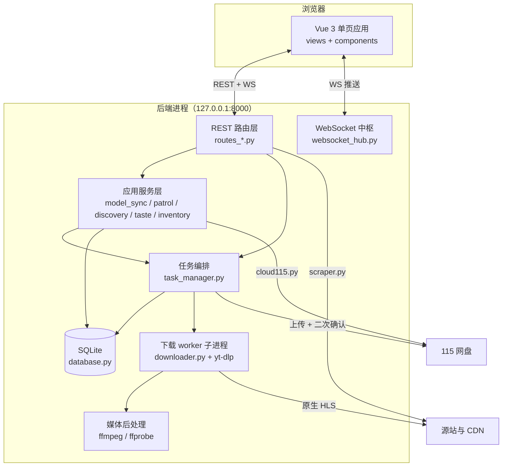
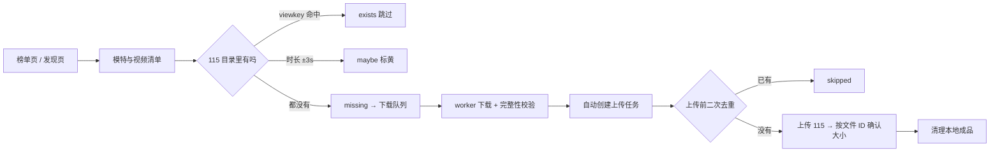

# Coffer 架构说明

> 面向“我要改这个项目”的读者：一张总览图、一份目录说明、一张“改哪里”对照表。
> 内部代号 PH-115；代码里的 `PH115_*` 前缀与 `data/` 布局保持原名。

## 1. 总览

```
单进程 FastAPI（只监听 127.0.0.1:8000） + 单页 Vue（hash 路由，构建产物由同一个进程托管）
        │  REST /api/*                         │  一条全局 WebSocket /ws
        ▼                                      ▼
应用服务层（同步 / 巡查 / 发现 / 审美 / 库存）  ←→  SQLite（WAL）
        │
        ▼
任务编排（TaskManager：排队、并发、重试、门禁）
        ├─ 抓取层  scraper.py（榜单 / 模特页 / 视频页 → m3u8）
        ├─ 下载层  downloader.py（每任务一个 worker 子进程，yt-dlp 原生 HLS）+ ffmpeg/ffprobe 校验
        └─ 云端层  cloud115.py（目录扫描 / 秒传 / 上传确认）
```

### 1.1 运行时组件



### 1.2 一次完整业务流



## 2. 目录树

```
coffer/
├─ README.md                  产品说明、一键部署、配置表、注意事项
├─ LICENSE                    MIT
├─ run.py                     开发入口：uvicorn 起 backend.main:app（仅 127.0.0.1）
├─ requirements.txt           源码依赖范围
├─ requirements-release.lock  CI 与一键部署使用的完整依赖闭包
├─ .env.example               配置样板（复制为 .env）
├─ .gitattributes / .gitignore
├─ .github/workflows/ci.yml   CI：Windows + Python 3.14 + Node 24
├─ backend/                   后端 55 个模块 / 19,144 行（见第 3 节）
├─ frontend/                  前端 88 个文件（见第 4 节）
├─ scripts/                   安装与运维脚本 8 个（见第 5 节）
├─ tests/                     测试 57 个文件 / 473 个用例（见第 6 节）
├─ models/visual/             SigLIP2 资产：清单 json（入库）+ onnx（忽略，约 101 MiB）
├─ design-system/             视觉规范：MASTER.md + pages/remote-login.md
└─ deploy/remote-access/      nginx 片段（手机远程访问，可选功能）
```

运行期生成、且不入库：`data/`（数据库、头像、预览、日志）、`downloads/`（下载成品与断点）、`tools/ffmpeg/`（本地固定版工具）。

## 3. backend 分层

按“谁能调谁”分组，同组内模块可以互相引用，跨组只允许向下。

### 3.1 HTTP 与协议层

| 模块 | 行数 | 职责 |
|---|---|---|
| `main.py` | 213 | lifespan 装配、中间件、诊断挂载、`/ws`、静态前端；重新导出所有旧路由名 |
| `routes_auth.py` / `routes_cloud.py` / `routes_discovery.py` / `routes_library.py` / `routes_models.py` / `routes_tasks.py` / `routes_taste.py` / `routes_ops.py` | 67–565 | 按域拆分的 REST 路由；**彼此不 import，也不 import `main`** |
| `api_schemas.py` / `api_wire.py` | 82 / 60 | 请求体校验（pydantic）与共享序列化 |
| `websocket_hub.py` | 144 | 每客户端有界队列、进度合并、终态可靠、慢客户端隔离 |
| `remote_auth.py` | 144 | 外网会话：Nginx 受信头 → HMAC + HttpOnly + Secure Cookie |
| `diagnostics.py` | 140 | `/api/diagnostics` 脱敏指标（不含 SQL、Cookie、路径） |

### 3.2 应用服务层（业务语义都在这里）

| 模块 | 行数 | 职责 |
|---|---|---|
| `model_sync.py` | 246 | 单模特全量同步：刷新 PH 与 115 内容、校验 CID、事务内发布 |
| `model_sync_coordinator.py` | 448 | 批量同步协调：每批一次目录快照、全局/单模特并发、等待者共享在飞同步 |
| `patrol.py` | 548 | 自动巡查：启停/间隔持久化、2 路受控并发、上游错误共享冷却 |
| `discovery.py` / `routes_discovery` 配套 | 89 | 发现页来源（主页/推荐/榜单/频道/片单…） |
| `library_index.py` | 465 | 115 库索引与成员判定（名字归一化、目录可信度） |
| `library_suggestions.py` | 37 | 只读绑定建议（每页一次 difflib 批处理，从不自动绑定） |
| `inventory_writer.py` | 125 | 上传成功后回写库存与统计 |
| `task_queries.py` / `model_queries.py` | 134 / 63 | 只读查询投影（任务列表、模特流水线状态） |
| `taste_service.py` / `taste_visual.py` / `taste_model.py` | 250 / 556 / 1391 | 审美：两人校准、本地 SigLIP2 特征、库模式排序与留出验证 |
| `preview_service.py` / `preview_image_store.py` | 489 / 173 | 视频预览封面抓取、缓存与失败冷却 |
| `avatar_service.py` / `avatar_store.py` / `avatar_audit.py` / `avatar_repair.py` | 137 / 108 / 263 / 352 | 头像下载、解码校验、WebP 落盘与存量修复 |

### 3.3 任务编排与运行参数

| 模块 | 行数 | 职责 |
|---|---|---|
| `task_manager.py` | 2839 | `manager` 单例：两条队列、并发上限、重试、门禁、状态广播 |
| `task_store.py` | 72 | 串行化状态持久化、有限锁重试、遥测限频落库 |
| `download_settings.py` / `resizable_limiter.py` | 127 / 60 | 页面可改的并发/限速/时段/防睡眠；运行中调整不打断任务 |
| `power.py` | 47 | `KeepAwake`：有任务在跑时阻止 Windows 自动睡眠 |
| `task_contracts.py` | 32 | 任务排序契约（前端 `contracts/taskState.js` 与之对齐） |

### 3.4 网络与协议层

| 模块 | 行数 | 职责 |
|---|---|---|
| `scraper.py` | 2079 | 三层抓取（榜单→模特→视频→m3u8）；域名白名单、重定向复校验、拒私网 |
| `downloader.py` | 2730 | 唯一网络引擎：每任务一个 worker 子进程、结构化遥测、停滞杀进程树、完整性校验 |
| `hls_composite.py` | 44 | v3 分轨/分时间段计划（逐段下载后本地合并） |
| `download_errors.py` | 232 | 失败分类与“可批量恢复”策略（未知/完整性失败 fail-closed） |
| `download_throttle.py` | 93 | CDN 429 整体冷却：不计次、按等级降并发 |
| `network_health.py` | 175 | 共享链路断流检测与恢复探测 |
| `cloud115.py` | 857 | 非官方 115 客户端：目录扫描（keep-alive）、扫码登录、上传委托 p115client |
| `upload_gate.py` | 109 | 上传闸门：探测被桶策略拒绝后暂停上传、定时重探 |

### 3.5 存储与不变式

| 模块 | 行数 | 职责 |
|---|---|---|
| `database.py` | 733 | 异步 SQLAlchemy + 幂等迁移（`_migrate`）、偏唯一索引、`ANALYZE` |
| `dedup.py` | 162 | 纯函数去重：viewkey 强匹配 → 时长 ±3s 弱匹配 → missing |
| `identity.py` | 4 | 名字键唯一的归一化规则（空白折叠 + casefold） |
| `image_assets.py` | 123 | 图片体积/类型/像素上限、解码校验、WebP 转码、原子写 |

### 3.6 通知与基础设施

| 模块 | 行数 | 职责 |
|---|---|---|
| `notifier.py` / `daily_digest.py` | 436 / 99 | Bark 推送（限频、连接失败重试一次）、每日 09:00 摘要 |
| `config.py` | 140 | pydantic-settings，读 `.env` |
| `logging_setup.py` | 22 | 日志轮转（4 × 5 MiB） |

## 4. frontend 结构

| 目录 | 文件数 | 内容 |
|---|---|---|
| `src/views/` | 6 | `Models`（封面优先媒体库）/ `Library`（115 权威视图）/ `Discovery` / `Taste` / `Downloads` / `Uploads` |
| `src/components/` | 21 | 卡片与弹窗：`ModelCard`、`ModelDrawer`、`VideoList`(+Modal)、`TaskTable`、`TaskQueuePage`、`PatrolBar`、`NotifyBar`、`CoverCarousel`、`LikedModelsWorkspace`、`TaskTray`、`DocumentPulse`、`RemoteLogin` 等 |
| `src/composables/` | 7 | `useTaskQueue`（队列状态机）、`useModelGrid`、`useTaskPulse`（全局任务概览）、`useRealtimeRefresh`（恢复补读）、`useModalFocus`/`useEscClose`/`useDialog`（弹窗栈） |
| `src/api/` | 2 + `api.js` | `http.js`（URL 前缀与错误归一）、`websocket.js`（全局单例 + 发布订阅） |
| `src/utils/` | 14 | `failureReason`（失败说人话）、`taskViews`（筛选）、`taskTray`/`documentPulse`（托盘与标签页）、`assetUrl`、`formatters`、`modalStack`、`shortcuts` 等 |
| `src/contracts/` | 1 | `taskState.js`：任务状态/排序契约（后端 `task_contracts.py` 的镜像） |
| `src/styles/` | 10 | 固定级联：`tokens → shell → controls → media → tasks-dialogs → responsive → library → taste → liked-models → media-library` |
| 根 | 4 | `main.js`（hash 路由）、`App.vue`（远程会话门控）、`style.css`（十文件导入）、`api.js`（兼容导出） |

另：`frontend/tests/` 15 个文件 = 14 个 `node --test` 用例 + `component-harness.mjs`；浏览器契约由 `playwright.config.mjs` 驱动。

## 5. scripts

| 脚本 | 用途 |
|---|---|
| `dev_launcher.ps1` | 开发启动器：start / stop / status / url，只回收自己记录的进程 |
| `lock_dependencies.py` | 校验（或 `--write` 更新）依赖锁闭包 |
| `rebuild_database.py` | 数据库重建与结构迁移 |
| `benchmark_reads.py` | 只读查询基准 |
| `validate_taste_model.py` / `generate_taste_results.py` | 视觉模型质量校验、离线批量生成推荐结果 |
| `scan_pollution.py` / `clean_pollution.py` | 历史污染“扫描 → 人工逐 fid 批准 → 删除”两阶段工具（默认只读） |

## 6. tests

| 组 | 代表文件 | 覆盖 |
|---|---|---|
| 任务与下载 | `test_task_manager_download.py`、`test_downloader.py`、`test_download_throttle.py`、`test_source_recovery.py` | 状态机、重试、429/410 冷却、断流、断点复用、完整性门禁 |
| 抓取与 HLS | `test_scraper_hls.py`、`test_scraper_parsing.py`、`integration_native_hls.py`、`integration_composite_hls.py` | DOM 解析、m3u8 解析、真实夹具下载与合并 |
| 同步与去重 | `test_model_sync.py`、`test_model_sync_coordinator.py`、`test_dedup_bucket_equivalence.py`、`test_library_index.py` | 单模特同步、批处理并发、去重随机对拍、库成员判定 |
| 数据与迁移 | `test_database_migration.py`、`test_database_rebuild.py`、`test_task_queries.py` | 幂等迁移、偏唯一索引、只读投影 |
| 安全与鉴权 | `test_security_and_task_identity.py`、`test_remote_auth.py`、`test_contracts.py`、`test_diagnostics.py` | 来源校验、会话、OpenAPI 基线、分层约束、诊断脱敏 |
| 审美与前端契约 | `test_taste_*.py`、`frontend/tests/*.test.mjs` | 库模式门控、留出验证、WS 单例、弹窗焦点、布局契约 |
| 辅助模块 | `api_patch.py`、`hls_fixtures.py`、`ui_remote_auth_fixture.py` | 同时给 `main` 与各路由模块打补丁；HLS 夹具；远程登录夹具 |

## 7. 任务状态与门禁

- **状态**：`queued → running → completed / failed / skipped`，另有 `paused`
- **下载阶段**：`resolving / downloading / waiting / processing / retrying`
- **五种“暂缓而不是失败”**：`rate_limited`（CDN 429，按 5/10/20/30 分钟升级冷却，并发 `limit >> level`）、`network_outage`（链路探测也失败，最长等 6 小时）、`upload_blocked`（115 拒绝本机上传）、`download_window`（不在允许时段）、`media_tools_unavailable`（ffmpeg/ffprobe 缺失）
- **两次去重**：入队前一次，上传前再一次（期间 115 可能已新增）
- **完整性**：封装前后包数必须全等；逐包 DTS 倒退 > 0.5s 判失败；断点复用需 fingerprint + `resume_safe` + 唯一 `.ytdl`

## 8. 数据模型（SQLite，26 张表）

| 组 | 表 |
|---|---|
| 站点与媒体 | `models`、`videos`、`model_preview_videos`、`source_profiles`、`source_snapshots`、`source_sync_runs` |
| 任务 | `tasks`（`model_id` 可空 + `(model_id, viewkey, task_type)` 偏唯一索引）、`runtime_settings` |
| 115 库存 | `cloud_model_folders`、`cloud_media_fingerprints`、`library_scan_runs` |
| 发现与候选 | `candidates`、`candidate_source_hits`、`candidate_source_observations`、`cross_source_matches`、`discovery_items` |
| 审美 | `feature_vectors`、`taste_comparisons`、`taste_model_runs`、`taste_model_scores`、`taste_result_feedback` |
| 遗留 | `model_aliases`、`preference_feedback`、`recommendation_runs`、`recommendation_scores` |

## 9. 运行与构建

| 形态 | 怎么起 | 前端来源 |
|---|---|---|
| 开发 | `python run.py`（uvicorn，无 reload） | `npm run dev` 起 5173，把 `/api`、`/ws` 代理到 8000 |
| 单端口 | `python run.py`（事先 `npm run build`） | 后端进程直接托管 `frontend/dist` |

- 不做二进制发行包：分发方式是源码 + 一键命令（见 README），省掉 PyInstaller、捆绑 ffmpeg 的体积与许可问题
- 依赖锁定：`requirements-release.lock` 由 `scripts/lock_dependencies.py` 在 Windows / Python 3.14 上校验
- CI：`windows-latest`，跑 Python 单测 473 例、两个本地 HLS 集成、前端 `npm test` + `build:check` + Playwright 契约
- 外部前置：`ffmpeg` + `ffprobe`（查找顺序：`FFMPEG_DIR` → `tools/ffmpeg` → PATH）；`models/visual/siglip2-vision-int8.onnx` 仅在用审美功能时需要

## 10. 改哪里

| 想做的事 | 改这些文件 |
|---|---|
| 加一个 API | `api_schemas.py` 加请求体 → 对应 `routes_*.py` 加路由 → `tests/contracts/openapi-baseline.json` 同步 → `test_contracts.py` 会守住 |
| 改去重规则 | `dedup.py`（纯函数）+ `test_dedup_bucket_equivalence.py` 的随机对拍 |
| 改下载重试/退避 | `task_manager.py` 的重试分支、`download_errors.py` 的分类、`NETWORK_RETRY_DELAYS` 等常量 |
| 改 CDN 限流行为 | `download_throttle.py`（冷却档位、并发降级） |
| 站点改版要修选择器 | `scraper.py`（榜单 `_collect_*`、视频列表容器、`flashvars` 正则） |
| 加一列数据库 | `database.py` 的模型 + `_migrate` 中登记；迁移版本号 `_SCHEMA_MIGRATION_VERSION` 同步 +1 |
| 改前端页面/交互 | `views/*.vue` + `components/*.vue`；跨页状态放 `composables/` |
| 改样式 | `styles/tokens.css` 改数值；其余九个文件按固定级联顺序被 `style.css` 导入 |
| 加一种任务类型 | `task_contracts.py`（排序）+ `database.Task` + `task_manager._pump` 派发分支 + 前端 `contracts/taskState.js` |
| 改远程访问 | `remote_auth.py` + `deploy/remote-access/nginx-ph115-location.conf`（两边必须同时改） |

## 11. 不可破坏的约束

1. 后端只绑 `127.0.0.1`，两个 Uvicorn 入口都用 `proxy_headers=False`（否则 `X-Forwarded-For` 会冲掉 TCP 对端校验）。
2. 路由模块之间、路由与 `main` 之间不互相 import（契约测试守着）。
3. 下载完整性门禁只准加严：包数全等、DTS 单调、断点四重门禁。
4. 限流/断流/上传闸门一律“不消耗尝试次数”，且用单调时钟。
5. SQLite 保持 WAL + `busy_timeout` + 串行化状态写入 + 遥测限频落库。
6. 不把原始 SQL、Cookie、媒体身份、本地路径写进 `/api/diagnostics`。
7. 前端只有一条全局 WebSocket（`subscribeWS`），不得恢复按视图连接。
8. 审美结果只在 AUC ≥ 0.65 且覆盖率 ≥ 80% 时发布，不静默回退旧推荐器。
